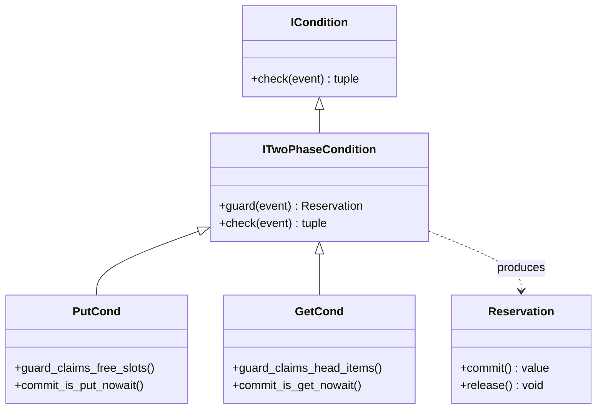
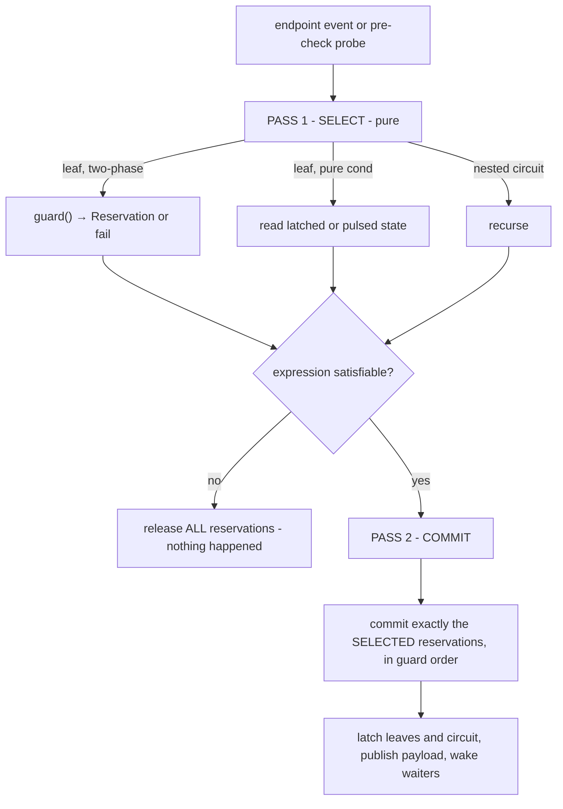
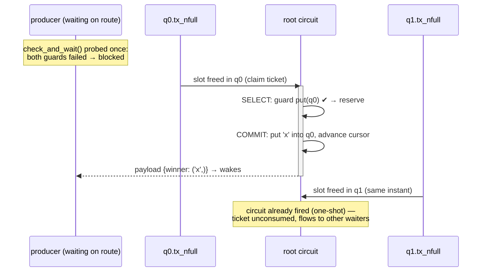
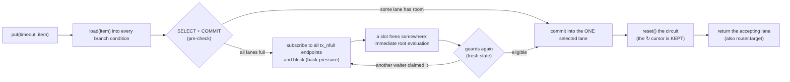
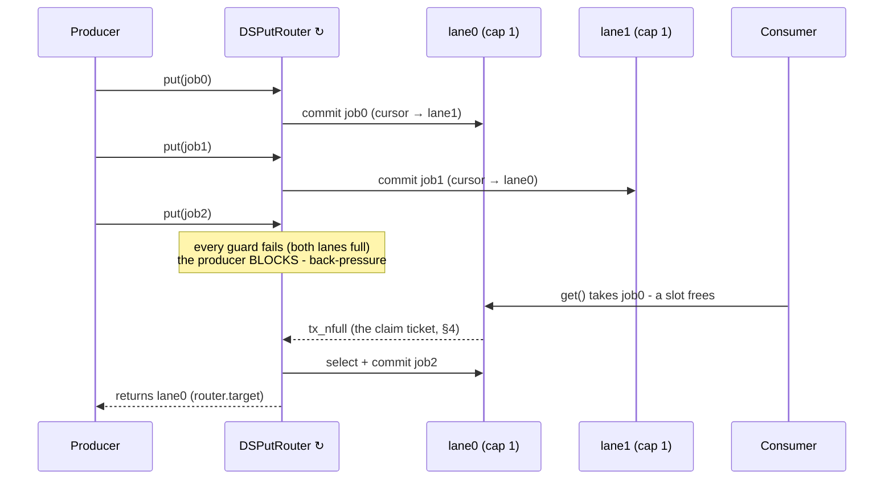

# Chapter 4a: Two-Phase Conditions (guard + commit)

!!! note "PubSubLayer2"
    Like everything in [Chapter 4](04-condition-filtering.md), this mechanism is
    specific to PubSubLayer2.

This chapter builds directly on [Chapter 4](04-condition-filtering.md) (filters
and circuits) and on the queue/resource *filter policies* of
[Chapter 6](06-components.md) (§6.2.8). It explains how **side-effecting
conditions** compose into circuits, and ends with the packaged form —
the **one-of-N routers** — shown with full diagrams.

Chapter 4 shows how **filters** and **circuits** combine *pure* conditions —
lambdas that look at an event and answer true/false. This chapter is about the
other kind of condition DSSim has: conditions that **do something** when they
pass. `queue.policy_for_put(obj)` and `queue.policy_for_get()` wrap conditions
whose check *is* the operation — "is there room?" is answered by actually
enqueuing, "is there an item?" by actually dequeuing.

DSSim gives such effectful conditions two forms, each intended for a
different situation:

* the **one-pass `check()`** — for a *standalone* wait, where there is exactly
  one candidate operation;
* the **two-phase `guard()` + `commit()`** — for waits *composed into
  circuits*, where several candidate operations compete or must succeed
  together, and the circuit arbitrates which of them actually happen.

---

## 1. The one-pass condition: standalone waits

A one-pass condition has a single operation:

```python
class ICondition:
    def check(self, event) -> tuple[bool, Any]: ...
```

For a queue putter policy, `check()` **tests and commits in one step**:

```
              check(event)
            ┌───────────────────────────────┐
   event ──▶│  room in queue?               │
            │    no  → (False, None)        │
            │    yes → put_nowait(obj) ─────┼──▶ item IS in the queue now
            │          (True, obj)          │
            └───────────────────────────────┘
```

The test and the effect are fused — which is exactly right for a
**standalone** wait such as `await queue.put(...)` or a single
`sim.filter(policy=...)`: there is only ever one candidate operation, so if
the test passes, committing immediately is precisely what was asked for.

## 2. What composed waits ask for

A circuit is a different situation: it holds **several** candidate operations
and decides an expression over them. For effectful conditions this creates
requirements that no single fused test-and-commit can express — the decision
about *which operations happen* belongs to the expression, not to any one
branch. Three requirements define the design.

### 2.1 OR is an arbitration: commit exactly one

Routing one item into whichever of two queues has room:

```python
route = sim.filter(q0.policy_for_put('x')) | sim.filter(q1.policy_for_put('x'))
```

Here OR does not mean "did any branch fire?" — it means "**perform exactly one
of these alternatives**". Even when both queues have room in the same instant,
the item must land exactly once, and *which* queue wins is a policy decision
(first in order, or fair rotation):

```
  q0.tx_nfull ──▶ branch A: could put 'x' into q0  ─┐
                                                    ├─▶ ╔══ OR ═══════════╗
  q1.tx_nfull ──▶ branch B: could put 'x' into q1  ─┘   ║ select ONE      ║──▶ 'x' in
                                                        ║ branch; only it ║   exactly one
                                                        ║ commits         ║   queue
                                                        ╚═════════════════╝
```

The selection must happen **before** any effect: the branches report what they
*could* do, the expression chooses, and only the chosen branch acts.

### 2.2 Probing must be pure

`check_and_wait()` probes the circuit before blocking. A probe asks "could the
expression be satisfied right now?" — a question, not an instruction. The
probe therefore needs to evaluate every branch **without acting**, and only
then perform the selected operations, exactly as any other evaluation.

### 2.3 AND is a transaction: all or nothing

```python
transfer = sim.filter(qa.policy_for_get()) & sim.filter(qb.policy_for_put(x))
```

This rendezvous means "**take from `qa` and place into `qb` as one step**".
While `qb` is full, the item must stay in `qa` — visible to every other
consumer — rather than sit in limbo inside a half-satisfied expression. AND
over effectful branches is a transaction: either every branch commits in the
same instant, or none does and nothing anywhere has changed.

---

## 3. The two-phase contract

Two-phase conditions express exactly this division of authority: a **pure
guard** that claims the resource ("I could do it — hold my place"), and a
**commit** that performs the operation once the expression has selected it —
with a `Reservation` object carrying the claim between the two:

```python
class Reservation:
    def commit(self) -> Any: ...     # perform the reserved operation
    def release(self) -> None: ...   # drop the claim, no side effect

class ITwoPhaseCondition(ICondition):
    def guard(self, event) -> Optional[Reservation]:
        '''Pure test: claim the resource if the operation could succeed now.'''

    def check(self, event):
        '''One-pass compatibility: guard + commit immediately.'''
        r = self.guard(event)
        return (False, None) if r is None else (True, r.commit())
```



(`PutCond`/`GetCond` are `DSQueue._PutCond` / `DSQueue._GetCond` — the conds
behind `policy_for_put` / `policy_for_get`.)

Because `check()` still exists (guard + immediate commit), a two-phase
condition **is** a one-pass condition whenever it stands alone:
`queue.put/get` and a lone `sim.filter(policy=...)` get the §1 semantics.
The guard/commit split engages where it is intended to: inside circuits.

### 3.1 Reservations on a queue

`DSQueue` keeps two transient counters:

```
   _reserved_in    slots claimed by pending put-reservations
   _reserved_out   items claimed (from the head) by pending get-reservations
```

A put guard passes when `len(buffer) + _reserved_in + n <= capacity`; a get
guard claims positions from the buffer head, starting *after* already-claimed
items. This is what makes sibling guards **see each other's claims** within
one evaluation:

```
   capacity 1, empty queue:      put('x') & put('y')
   guard(x): 0 + 0 + 1 ≤ 1  ✔  reserve → _reserved_in = 1
   guard(y): 0 + 1 + 1 > 1  ✘  → AND is not satisfiable → release x's claim
   nothing was committed; the queue is untouched (the §2.3 transaction rule).
```

Three properties keep this simple — no persistence, no locks:

1. **Reservations live inside one synchronous evaluation pass.** Every claim
   is committed or released before the pass returns, and nothing else runs in
   between (single-threaded event dispatch).
2. **Rollbacks are LIFO** (a failed subtree releases its claims before any
   further guard runs), so get-claims stay contiguous at the buffer head.
3. **Commits run in guard order**, so at commit time each get-reservation's
   items are exactly the head items, and each put fits the capacity its guard
   claimed. Consequence: `put_nowait` / `get_nowait` needed **no changes** —
   they stay completely reservation-unaware.

---

## 4. Two-phase conditions in a filter

A `DSFilter` whose cond is two-phase behaves in two modes, matching the two
intended situations of the introduction:

```
  standalone (no parent circuit)          leaf inside a circuit
  ──────────────────────────────          ─────────────────────────────────
  endpoint event → check()                endpoint event → NO check, NO commit
                 = guard + commit                        → ask the ROOT circuit
  (the one-pass semantics of §1)                           to evaluate NOW
```

The in-circuit rule is absolute: **a two-phase leaf never commits
autonomously.** Its endpoint event — "a slot freed", "an item arrived" — is
treated as a *claim ticket*. The leaf immediately triggers a root-circuit
evaluation (`_try_root_fire`):

* if the root **can** fire right now (its select pass succeeds), the commit
  happens as part of that evaluation, and the leaf reports the endpoint event
  as **consumed** — so, on the CONSUME tier, subscribers behind it do not see
  a ticket that was used;
* if the root **cannot** fire (an AND still waiting on its other branch), the
  leaf reports the event **unconsumed**, and the very same ticket flows on to
  the next CONSUME subscriber — e.g. a plain `queue.put()` waiter that *can*
  use the slot.

This preserves the pub/sub arbitration described in Chapter 3: the CONSUME
tier still decides who gets a freed slot, and the circuit participates in that
arbitration honestly — it claims the ticket exactly when it uses it.

---

## 5. Two-phase evaluation in the circuit

A circuit containing any two-phase condition evaluates in **two passes** —
select, then commit. (Circuits built only from pure conditions keep the
latching evaluation described in Chapter 4.)



The selection rules per node:

* **OR** walks its branches in *selector order* and takes the **first**
  eligible one — later branches are never even guarded, so no stray claims.
  This is the §2.1 arbitration; the pre-check probe (§2.2) goes through this
  same select+commit pass as any other evaluation.
* **AND** guards **all** branches; if any fails, every claim taken for the
  subtree is released and the node reports unsatisfiable — the §2.3
  transaction.
* **Nested circuits** recurse — an inner circuit under a two-phase root never
  commits on its own; commit authority always belongs to the root evaluation.

### 5.1 The OR selector: ordered vs round robin

The OR tie-break is a declared policy on the circuit:

```python
route = (f0 | f1 | f2)                            # 'ordered' (default)
route = (f0 | f1 | f2).set_selector('round_robin')
```

```
   ordered (overflow chain)             round_robin (fair rotation)
   ────────────────────────             ───────────────────────────
   try f0 → f1 → f2, always             cursor starts after the branch
   from the left: fill the              that fired last; full/empty
   first, spill to the next             branches are skipped; the cursor
                                        advances only on a real commit
```

The cursor lives **on the circuit object** — which is why a circuit kept
across loop iterations is a *static router with state*, not a rebuilt
expression.

### 5.2 A full timeline

Round-robin route into two full queues; another process frees both queues at
the same simulation instant:



Exactly one queue received the item, even though both became available in the
same instant — the §2.1 arbitration holds by construction, because the only
place a commit can occur is inside one select+commit pass.

### 5.3 Atomicity

The entire select+commit pass is one synchronous call. Two facts make it
race-free without locks:

* `sim.signal()` only **queues** notifications (`now_queue`) — a commit's
  `tx_nempty`/`tx_changed` wake-ups dispatch *after* the pass returns, at the
  same timestamp. The evaluation can never re-enter itself.
* Between a guard and its commit, no other process can run — a
  "check, then lose the slot before acting" race is structurally impossible.

---

## 6. The two forms at a glance

| | one-pass `check()` | two-phase `guard()` + `commit()` |
|---|---|---|
| intended for | a **standalone** wait — one candidate operation | waits **composed into circuits** — competing or joint operations |
| operation shape | test **+ commit** fused | pure claim → the expression commits the selected branches |
| standalone filter / `queue.put/get` | the natural form | identical behavior (inherited `check()`) |
| OR of effectful branches | — (a single candidate has nothing to arbitrate) | commits exactly **one**, selector-chosen (§2.1) |
| pre-check (`check_and_wait`) | test-and-commit, the standalone semantics | pure probe + selected commits (§2.2) |
| AND of effectful branches | — | all-or-nothing, atomic in the instant (§2.3) |
| shared resource between branches | — | guards see sibling claims (reservation counters) |
| endpoint event on the CONSUME tier | consumed by a successful check | consumed **iff** the root evaluation committed |
| reuse across loop iterations | rebuild or `reset()` per cycle (§6.2.9 of [Chapter 6](06-components.md)) | reuse the circuit; cursor persists; `reset()` re-arms |

---

## 7. Composing effectful waits directly

**One-of-N routing with back-pressure** (the raw circuit form):

```python
route = (sim.filter(q0.policy_for_put(item))
       | sim.filter(q1.policy_for_put(item))
       | sim.filter(q2.policy_for_put(item))).set_selector('round_robin')
payload = await route.check_and_wait(timeout)   # blocks while ALL queues are full
```

**Rendezvous** — move an item from `qa` to `qb` only when both ends are ready,
never holding it in limbo:

```python
transfer = sim.filter(qa.policy_for_get()) & sim.filter(qb.policy_for_put(x))
```

**Routing with an escape hatch** — pure and effectful branches compose freely;
if the timeout branch wins, no queue is touched:

```python
result = await (route | sim.filter(cond=timeout_future)).check_and_wait()
```

### 7.1 Advanced: your own two-phase condition in an OR

`ITwoPhaseCondition` is an open interface — any component with claimable state
can join circuits with the full §2 semantics. The example: a `CreditPool`
holding a spendable balance, and a payment that takes 5 credits from **cash if
possible, else from a voucher** — an OR with the `ordered` (preference)
selector, blocking with back-pressure until some account can cover it.

The component owns the state, a *wake-up endpoint*, and a policy factory:

```python
from dssim import DSComponent, ITwoPhaseCondition, Reservation
from dssim.pubsub.cond import DSFilter

class CreditPool(DSComponent):
    '''A spendable balance with a wake-up endpoint fired on every deposit.'''

    def __init__(self, balance=0, **kwargs):
        super().__init__(**kwargs)
        self.balance = balance
        self._reserved = 0                     # transient claims (one evaluation pass)
        self.tx_deposit = self.sim.publisher(name=self.name + '.tx_deposit')

    def deposit(self, n):
        self.balance += n
        self.sim.signal(self.tx_deposit, self.tx_deposit)   # "spending may newly succeed"

    def spend_nowait(self, n):
        if n > self.balance:
            return 0
        self.balance -= n
        return n

    def policy_for_spend(self, n):
        return {'cond': _SpendCond(self, n),
                'sigtype': DSFilter.SignalType.LATCH,
                'eps': {self.tx_deposit: {'tier': self.tx_deposit.Phase.CONSUME,
                                          'params': {}}},
                'one_shot': True}
```

The condition claims in `guard()`, acts in the reservation's `commit()`:

```python
class _SpendCond(ITwoPhaseCondition):
    def __init__(self, pool, n):
        self.pool, self.n, self.value = pool, n, 0

    def guard(self, event):
        # PURE apart from the claim itself: sibling guards in the same
        # evaluation see the reservation and cannot over-claim the balance.
        if self.pool.balance - self.pool._reserved >= self.n:
            self.pool._reserved += self.n
            return _SpendReservation(self, self.n)
        return None

    def cond_value(self):
        return self.value


class _SpendReservation(Reservation):
    def __init__(self, cond, n):
        self.cond, self.n, self._active = cond, n, True

    def commit(self):
        assert self._active
        self._active = False
        pool = self.cond.pool
        pool._reserved -= self.n
        got = pool.spend_nowait(self.n)        # guaranteed: the guard claimed it
        self.cond.value = got
        return got

    def release(self):
        assert self._active
        self._active = False
        self.cond.pool._reserved -= self.n
```

Composed in OR, the custom conditions behave exactly like the built-in
policies:

```python
cash = CreditPool(balance=2, sim=sim, name='cash')
voucher = CreditPool(balance=6, sim=sim, name='voucher')

pay = sim.filter(cash.policy_for_spend(5)) | sim.filter(voucher.policy_for_spend(5))
payload = yield from pay.check_and_gwait(20)   # 5 credits leave exactly ONE account
```

A run with a deposit arriving later shows the preference order, the exactly-one
commit, and the blocking wake-up, all at once:

```
   t=0   cash has 2 (guard fails), voucher has 6 (guard passes)
         → 5 spent from voucher            cash=2  voucher=1
   t=0…3 next payment: neither account covers 5 → the buyer BLOCKS
   t=3   cash.deposit(4) fires tx_deposit  → root evaluation
         → 5 spent from cash (the PREFERRED branch, ordered selector)
                                            cash=1  voucher=1
```

What a custom condition must guarantee, in checklist form:

1. **`guard()` is pure apart from its claim.** It may only bump a transient
   reserved-counter on the shared state — so sibling guards in the same
   evaluation see the claim (`balance - _reserved`), and nothing observable
   changes if the expression is not satisfied.
2. **A passed guard's `commit()` cannot fail.** Claims subtract from
   availability, commits only consume what their own guard claimed — the
   aggregate invariant that lets `spend_nowait` stay reservation-unaware.
3. **`commit()` / `release()` are single-use** and both drop the claim;
   the circuit calls exactly one of them, always within the same synchronous
   evaluation pass (no persistence, no timeouts on claims — see §5.3).
4. **The policy's endpoint fires whenever the operation could *newly*
   succeed** (here: on every deposit), on the CONSUME tier — that event is the
   claim ticket of §4, consumed precisely when the circuit commits.
5. **`cond_value()` returns the committed value** — it becomes the branch's
   entry in the circuit payload.

---

## 8. The routers: one-of-N as a component

The routing pattern of §7 has a per-iteration cost when driven by hand: rebind
the item into every branch, wait, re-arm. `DSPutRouter` / `DSGetRouter` package
that cycle into **one call per operation** over a *static* circuit built once at
construction:

```python
router = DSPutRouter(*lanes, selector='round_robin')
target = await router.put(timeout, item)     # the lane that accepted, or None

router = DSGetRouter(*lanes, selector='round_robin')
item = await router.get(timeout)             # router.source = the lane it came from
```

### 8.1 The topology

One producer feeding five lanes, one consumer draining them — both through
routers, both round-robin (this is the `round_robin_router_pubsub` demo, which
the Designer renders with `↻ 1/N` routing marks on both transfers):

```
                ┌───────────────────── DSPutRouter ──────────────────────┐
                │   static OR circuit of put policies — built ONCE;      │
   Producer     │   the ↻ cursor lives on the circuit                    │
   ──────────── │                                                        │
   gput(t, job) │   guard(lane0)? guard(lane1)? … guard(lane4)?          │
   blocks while │        │            │               │                  │
   ALL lanes    │        └───── select ONE (↻) ───────┘                  │
   are full     │                     │ commit                           │
                └─────────────────────┼──────────────────────────────────┘
                                      ▼
                  lane0 [▭▭]  lane1 [▭ ]  lane2 [▭▭]  lane3 [ ]  lane4 [▭]
                                      │
                ┌─────────────────────┼─────────── DSGetRouter ──────────┐
                │                     │ commit (take ONE job)            │
   Consumer     │        ┌───── select ONE (↻) ───────┐                  │
   ──────────── │        │            │               │                  │
   gget(t)      │   guard(lane0)? guard(lane1)? … guard(lane4)?          │
   blocks while │                                                        │
   ALL lanes    │   static OR circuit of get policies — the ↻ cursor     │
   are empty    │   starts after the lane served last                    │
                └────────────────────────────────────────────────────────┘
```

Every `put` commits into **exactly one** lane and every `get` drains **exactly
one** — the two-phase guarantee of §5 — while full/empty lanes are skipped by
the guards and the cursor keeps the rotation fair.

### 8.2 One call, inside

What a single `router.put(timeout, item)` does:



The `reset()` between operations is what makes the router a *static* component:
the circuit, its subscriptions and its cursor persist — only the payload is
rebound per call.

### 8.3 Round robin and back-pressure on a timeline

Two lanes of capacity 1; the producer outruns the consumer:



The blocked producer is exactly the mechanism of §4-§5 at work: the freed
slot's notification arms the circuit, one select+commit pass claims it
atomically, and the CONSUME-tier arbitration stays honest toward any *other*
waiter on the same lanes.

### 8.4 Resources route too

Routers accept a homogeneous set of **plain resources** — claims become scalar
amounts instead of items:

```
   Refinery ── put(t, 3) ──▶ ╔═ DSPutRouter ═╗ ──▶ tank_a (cap 10) ▓▓▓▓▓▓▓░░░
                             ║  ONE tank per ║      tank_b (cap 10) ▓▓▓░░░░░░░
                             ║  deposit  (↻) ║ ──▶  tank_c (cap 10) ▓▓▓▓▓░░░░░
                             ╚═══════════════╝
```

```python
router = DSPutRouter(tank_a, tank_b, tank_c, selector='round_robin')
tank = await router.put(timeout, 3)          # 3 units into exactly ONE tank

router = DSGetRouter(tank_a, tank_b, tank_c, amount=2)
got = await router.get(timeout)              # 2 units drained from ONE tank
```

Two rules the router enforces at construction:

* **Homogeneous channels** — all queues, or all plain resources (`ValueError`
  otherwise).
* **Two-phase channels only** — a priority/preemptive resource carries a
  one-pass condition (preemption is inherently effectful — see the scope
  note in §9), so it belongs to standalone waits; the router refuses it
  with `ValueError`.

### 8.5 Choosing the form

| you need | reach for |
|---|---|
| route each item/amount to one of N, in a loop | `DSPutRouter` / `DSGetRouter` |
| one-off one-of-N wait | the raw OR circuit (§7) |
| conjunction (rendezvous, fuel-and-dispatch) | the raw AND circuit (§7) |
| routing plus a timeout/escape branch | `router.circuit \| escape_filter` (drive manually) |
| lossy fan-out, no back-pressure needed | `DSPub` + `NotifierRoundRobin` ([Chapter 3](03-pubsub-layer2.md)) |

---

## 9. Semantics worth knowing

* **Two-phase leaves are level-triggered inside circuits.** They are
  re-guarded at every evaluation, so an eligibility observed earlier never
  outlives the state that produced it. Pure filters keep their LATCH/PULSED semantics untouched.
* **Loop reuse**: after a one-shot circuit fires, call `reset()` — it clears
  the latches and re-attaches subscriptions; the round-robin cursor is
  deliberately preserved. Rebind put payloads with `policy['cond'].load(item)`
  (the routers do both internally).
* **Timeout returns `{}`** (an empty payload map) from circuit waits — a
  falsy value, but not `None`. This is framework-wide circuit behavior, not
  specific to two-phase.
* **Restrictions**: a two-phase condition under a **negated** circuit, or used
  as a **resetter**, raises `ValueError` — "fire-and-reset with side effects"
  has no coherent meaning.
* **Scope**: `DSQueue` put/get policies are two-phase, and so are **plain**
  `DSResource` policies (`policy_for_get(amount)`, and the new
  `policy_for_put(amount)` with capacity back-pressure) — resource claims are
  scalar amounts instead of slots/items, so pools compose into circuits and
  routers exactly like queues, including cross-kind circuits
  (`pool.policy_for_get(2) & queue.policy_for_put(job)` is an atomic
  fuel-and-enqueue rendezvous). **Priority / preemptive resources carry
  one-pass conditions** — preemption reclaims units from victims, which a
  pure guard cannot express — so they are intended for standalone waits and
  the routers refuse them (`ValueError`). Container conditions are one-pass
  as well.
* **Routers accept homogeneous channel sets** — all queues or all plain
  resources; for resources, `router.put(timeout, n)` deposits `n` units into
  exactly one pool and `DSGetRouter(..., amount=n)` drains `n` units from
  exactly one.
