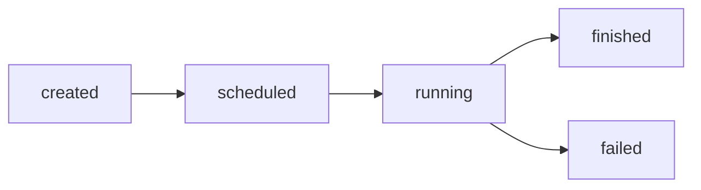

# Chapter 7: Agents

## 7.1 What Is an Agent?

A `DSAgent` is an **active entity** with its own process and lifecycle state. Where Chapter 5 showed bare processes (generators/coroutines scheduled directly) and Chapter 6 showed passive coordination components (queues, containers, resources), an agent ties the two together: it bundles a process body with ergonomic, *self-aware* methods for interacting with components, and it publishes a timeline of everything it does.

Use a `DSAgent` when you want to model a thing that *acts over time* — a customer, a worker, a packet, a vehicle, a robot — and you want one or more of:

- A process body that reads top-to-bottom (`hold`, `passivate`, `activate`, `wait`).
- Built-in lifecycle state tracking (`created → scheduled → running → finished`/`failed`).
- Queue/container/resource helpers that propagate aborts correctly (see [Chapter 6, §6.5](06-components.md#65-dsagent-queue-and-resource-helpers)).
- A free, non-intrusive event timeline (`tx_changed`) that history and statistics probes can observe.

!!! note "PubSubLayer2 only"
    `DSAgent` is a PubSubLayer2 feature. It is built on the publisher/subscriber stack — its `tx_changed` timeline, the container/resource helpers, and the agent probes all rely on it. The Lite layer has no agent abstraction; with `DSLiteQueue` / `DSLiteResource` you write plain processes (see [Chapter 5](05-processes.md)) and forgo the agent's lifecycle state, helpers, and observability.

`DSAgent` lives in PubSubLayer2.

```python
from dssim import DSAgent
```

---

## 7.2 Defining and Running an Agent

Subclass `DSAgent` and implement `process`. The body may be either a generator (`yield from ...`) or a coroutine (`async def` / `await`). The agent schedules its process automatically at construction time — you do **not** call `sim.schedule` yourself.

=== "Generator style"

    ```python
    from dssim import DSSimulation, DSAgent

    sim = DSSimulation()

    class Greeter(DSAgent):
        def process(self):
            print(f"t={sim.time}: hello")
            yield from self.hold(3)          # pause 3 time units
            print(f"t={sim.time}: goodbye")

    Greeter(sim=sim)
    sim.run(10)
    ```

=== "Coroutine style"

    ```python
    from dssim import DSSimulation, DSAgent

    sim = DSSimulation()

    class Greeter(DSAgent):
        async def process(self):
            print(f"t={sim.time}: hello")
            await sim.sleep(3)
            print(f"t={sim.time}: goodbye")

    Greeter(sim=sim)
    sim.run(10)
    ```

### 7.2.1 Constructor arguments

```python
Greeter(sim=sim)                       # auto-named: "Greeter.0", "Greeter.1", ...
Greeter(name="greeter_a", sim=sim)     # explicit name
```

Any extra positional/keyword arguments are forwarded to `process`:

```python
class Worker(DSAgent):
    def process(self, worker_id, speed=1.0):
        ...

Worker(7, speed=2.0, sim=sim)          # process(worker_id=7, speed=2.0)
```

`change_ep` lets several agents share one change-notification publisher (useful when one probe should observe a whole fleet — see [§7.6](#76-monitoring-a-fleet-of-agents)).

---

## 7.3 Agent Process Vocabulary

These methods are the salabim-style "process control" verbs. Generator forms are shown; the `async` agent methods `wait` and the awaitable component helpers also exist.

| Method | Meaning |
|---|---|
| `yield from self.hold(t)` | Pause for duration `t` (maps to `sim.gsleep`). |
| `yield from self.passivate(timeout=inf)` | Block until the agent receives **any** event (or timeout). |
| `self.activate(event=True)` | Send an event to this agent, waking a `passivate`/`wait`. |
| `self.signal(event)` | Low-level: deliver an event to the agent's process. |
| `yield from self.gwait(timeout, cond)` | Block until an event satisfying `cond` arrives. |
| `await self.wait(timeout, cond)` | Coroutine form of `gwait`. |

A second agent (or any process) wakes a passivated agent by calling `activate`:

```python
class Sleeper(DSAgent):
    def process(self):
        print(f"t={sim.time}: sleeping")
        event = yield from self.passivate()      # blocks indefinitely
        print(f"t={sim.time}: woke up with {event!r}")

sleeper = Sleeper(sim=sim)

def alarm():
    yield from sim.gwait(5)
    sleeper.activate("ring")                     # wakes the sleeper at t=5

sim.schedule(0, alarm())
sim.run(10)
# t=0: sleeping
# t=5: woke up with 'ring'
```

### 7.3.1 Component helpers

Inside a process, prefer the agent helpers over calling the component directly: they emit timeline events and propagate `DSAbortException` so the agent's scheduled process is aborted cleanly. They mirror the component API one-to-one (see [Chapter 6, §6.5](06-components.md#65-dsagent-queue-and-resource-helpers)).

```python
class Customer(DSAgent):
    async def process(self):
        await self.enter(lobby, timeout=5)       # container.put(self)
        teller = await self.get(tellers, timeout=10)   # resource.get()
        await sim.sleep(service_time)
        await self.put(tellers)                  # release
        self.leave(lobby)                        # container.remove(self)
```

Container helpers: `enter` / `genter` / `enter_nowait`, `leave`, `pop` / `gpop` / `pop_nowait`.
Resource helpers: `get` / `gget` / `get_n` / `gget_n`, `put` / `gput` / `put_n` / `gput_n`, `put_nowait` / `put_n_nowait`.

---

## 7.4 Lifecycle and the State Model

Every agent carries a `state` string that the framework advances automatically:



| State | Set when | `reason` on the event |
|---|---|---|
| `created` | object constructed | — |
| `scheduled` | process queued at t=0 | `schedule` |
| `running` | process body starts | `process_start` |
| `finished` | process returns normally | `process_finish` |
| `failed` | process raises | `process_fail` |

Each transition fires an event of `change_type='state'` on `tx_changed`. The `process` verbs and component helpers in between fire events of `change_type='action'` (`reason` is `hold`, `enter`, `get`, `leave`, …).

!!! note "Construction-time transitions"
    `created → scheduled` happens inside `__init__`, before you can attach a subscriber to that agent's own `tx_changed`. The first state event most observers see is `running` (`process_start`). To capture earlier transitions, pass a shared `change_ep` that already has subscribers, or attach a probe to a publisher created up front.

---

## 7.5 Observing an Agent: `tx_changed`

Every agent owns a publisher `agent.tx_changed`. It emits one event per state change and per action. The event is a plain dict:

```python
{
    'kind': 'agent_state',
    'change_type': 'state' | 'action',
    'agent': <the DSAgent>,
    'state': 'running',          # state at emit time
    'prev_state': 'scheduled',   # previous state (state changes)
    'reason': 'process_start',   # or 'hold', 'enter', 'get', ...
    'time': 0.0,
    'details': {...},            # present for actions, e.g. {'timeout': 3, 'success': True}
}
```

Subscribe directly for ad-hoc monitoring (`PRE` phase so you observe without consuming):

```python
class Worker(DSAgent):
    def process(self):
        yield from self.hold(1)
        yield from self.passivate()

agent = Worker(sim=sim)

timeline = []
agent.tx_changed.add_subscriber(
    sim.callback(lambda e: timeline.append((e['time'], e['change_type'], e['reason']))),
    agent.tx_changed.Phase.PRE,
)
sim.run(10)
# timeline == [(0,'state','process_start'), (1,'action','hold'), ...]
```

For anything beyond a quick callback, use the built-in probes below rather than hand-rolling accumulation.

---

## 7.6 Agent Statistics and History Probes

Three ready-made probes attach to an agent and observe `tx_changed` in the `PRE` phase — they never alter agent behavior. They come from `DSAgent` via `add_history_probe()` / `add_stats_probe()` / `add_activity_probe()` (the probe classes are also exported as `AgentHistoryProbe`, `AgentStatsProbe`, and `AgentActivityProbe`). See [Chapter 9](09-probes.md) for the broader probe framework.

### 7.6.1 History probe — a readable event log

`AgentHistoryProbe` records every event in order and renders it for debugging.

```python
from dssim import DSSimulation, DSAgent

sim = DSSimulation()

class Worker(DSAgent):
    def process(self):
        yield from self.hold(1)
        self.activate("ping")
        yield from self.passivate()
        return "done"

agent = Worker(sim=sim)
hist = agent.add_history_probe()        # optional: max_events=N to cap a ring buffer
sim.run(10)

print(hist.format_history())
```

```text
Agent history: Worker.0 (5 events)
[001] t=0 scheduled -> running (process_start)
[002] t=1 action:running (hold) | event=None, timeout=1
[003] t=1 action:running (activate) | event='ping'
[004] t=1 action:running (passivate) | event='ping', timeout=inf
[005] t=1 running -> finished (process_finish) | value='done'
```

(`details` keys are rendered in alphabetical order. `passivate` reports `event='ping'` because the preceding `activate("ping")` had already queued the event, so the wait returns immediately.)

| Method | Returns |
|---|---|
| `hist.history()` | list of raw event dicts (most recent capped by `max_events`) |
| `hist.format_history(include_details=True, with_header=True)` | formatted multi-line string |
| `hist.dump_history(file=None, ...)` | prints (or writes to a file object) and returns the string |
| `hist.reset()` | clear recorded events |

### 7.6.2 Stats probe — aggregated metrics

`AgentStatsProbe` accumulates counts and per-state residence time. Call `stats()` after the run (it finalizes the time spent in the current state up to `sim.time`).

```python
class Worker(DSAgent):
    def process(self):
        yield from self.hold(1)
        self.activate("ping")
        yield from self.passivate()
        return "done"

agent = Worker(sim=sim)
stats = agent.add_stats_probe()
sim.run(10)

s = stats.stats()
print(f"events:       {s['event_count']}")          # 5
print(f"  state:      {s['state_event_count']}")     # 2
print(f"  action:     {s['action_event_count']}")    # 3
print(f"final state:  {s['current_state']}")         # finished
print(f"time running: {s['state_time']['running']}") # 1.0
print(f"time finished:{s['state_time']['finished']}")# 9.0
print(f"action mix:   {s['reason_counts']}")         # {'hold':1,'activate':1,'passivate':1,...}
```

The `stats()` dict contains:

| Field | Meaning |
|---|---|
| `start_time`, `end_time`, `duration` | observation window |
| `event_count` | total events seen |
| `state_event_count` / `action_event_count` | split by `change_type` |
| `current_state` | latest state |
| `state_time` | `{state: total_time_in_state}` (time-weighted) |
| `state_entry_counts` | `{state: number_of_entries}` |
| `reason_counts` | `{reason: count}` across all events |

`get_statistics()` is an alias for `stats()`; `get_history()` aliases `history()`.

!!! note "`state_time` covers lifecycle states only"
    `AgentStatsProbe.state_time` reports time in the five lifecycle states (`created`/`scheduled`/`running`/`finished`/`failed`). It does **not** break `running` down into "time spent passivated / waiting / requesting", because those are *actions*, not states. For that breakdown, use the activity probe below.

### 7.6.3 Activity probe — time per activity and per resource

`AgentActivityProbe` answers "how long was this agent holding / passivated / waiting, and how long did it block on a *specific* resource or container?" It needs no change to the agent: each blocking action event (`hold`, `passivate`, `wait`/`gwait`, `get*`/`put*`, `enter`/`pop`) is emitted when the call returns, so the interval since the agent's previous transition is the time spent in that activity. Instantaneous actions (`activate`, `*_nowait`, `leave`) are counted but cost no simulated time.

```python
sim = DSSimulation()
teller = sim.resource(amount=0, capacity=1, name="teller")

class Customer(DSAgent):
    def process(self):
        yield from self.gget(teller, timeout=float('inf'))   # queue for the teller
        yield from self.hold(2)                              # being served
        self.put_nowait(teller)

cust  = Customer(sim=sim)
probe = cust.add_activity_probe()

def feeder():                       # teller becomes free at t=3
    yield from sim.gwait(3)
    teller.put_nowait()
sim.schedule(0, feeder())
sim.run(20)

s = probe.stats()
print(s['time_by_activity'])        # {'gget': 3.0, 'hold': 2.0}
print(probe.time_in('hold'))        # 2.0
print(probe.time_waiting_for(teller))  # 3.0  (also accepts the name "teller")
```

| Field / method | Meaning |
|---|---|
| `time_by_activity` | `{verb: seconds}` for blocking verbs (`hold`, `passivate`, `gwait`, `gget`, …) |
| `count_by_activity` | `{verb: count}` for **all** action verbs (including instantaneous ones) |
| `time_by_resource` | `{resource_name: seconds}` — time blocked on each resource (`get*`/`put*`) |
| `time_by_container` | `{container_name: seconds}` — time blocked on each container (`enter`/`pop`) |
| `pending_time` | residual time not attributed to a completed block (a still-running agent, or a `hold`/`wait` aborted without emitting its own event) |
| `time_in(activity)` | convenience accessor for `time_by_activity` |
| `time_waiting_for(target)` | time blocked on a resource/container (pass the object or its name) |

The sum of `time_by_activity` values equals the agent's active lifetime (`process_start` → process end), since simulated time only advances inside blocking calls. An immediate, non-blocking acquire (`gget` when the resource is already available) is correctly recorded as 0.

!!! warning "Attribution requires the agent's own methods"
    The activity probe sees only what the agent **emits on `tx_changed`**, and events are emitted exclusively by the agent's own verbs — the process controls (`hold`, `passivate`, `wait`/`gwait`) and the container/resource **helpers** (`enter`/`leave`/`pop`, `get*`/`put*`; see [§7.3.1](#731-component-helpers)). If a process blocks by calling a component or the scheduler **directly** — e.g. `yield from resource.gget(...)` instead of `yield from self.gget(resource)`, or `yield from sim.gsleep(...)` instead of `yield from self.hold(...)` — no event fires, and that wait time is **silently folded into the next emitted activity** rather than dropped. For example, bypassing `self.gget` for a 3-unit resource wait before a 2-unit `self.hold` reports `hold = 5.0` and no resource entry, not `gget = 3.0`. For correct attribution, always block through the agent methods.

!!! note "Resource/container granularity"
    `time_by_resource` / `time_by_container` are populated from the `get*`/`put*` and `enter`/`pop` **agent helpers** (which carry the target in the event), so name your resources/containers (`sim.resource(..., name="teller")`) for readable keys. Time spent in a generic `wait`/`gwait` on a custom condition is attributed to `'wait'`/`'gwait'`, not to a specific resource.

### 7.6.4 Attaching, naming, and detaching

```python
p = agent.add_stats_probe(name="ops")   # probe.name == f"{agent.name}.ops"
agent.remove_probe(p)                    # detaches and stops observing
```

`add_probe(probe)` accepts any object implementing `attach(agent)`, so you can write custom probes that subscribe to `tx_changed` the same way the built-ins do.

---

## 7.7 Generating Agents with `PCGenerator`

`PCGenerator` is a built-in agent that periodically instantiates a component class — the standard "arrivals" source for queueing models. Pass the class to instantiate and a `wait_method` returning the inter-arrival delay.

```python
from dssim import DSSimulation, DSAgent, PCGenerator

sim = DSSimulation()

class Customer(DSAgent):
    def process(self):
        yield from self.hold(2)          # time in system

# A new Customer every 1.0 time unit (default wait_method)
PCGenerator(Customer, sim=sim)

# Or a custom inter-arrival time (e.g. exponential):
# PCGenerator(Customer, wait_method=lambda last: random.expovariate(0.5), sim=sim)

sim.run(10)
```

`wait_method` receives the most recently created object and returns the delay before the next creation.

!!! note "Single-simulation assumption"
    `PCGenerator` instantiates the target class with no explicit `sim`, so each new instance binds to the process-wide default simulation (the **first** `DSSimulation` created). This is exactly what you want in the usual one-simulation script, but if you run several simulations in one process the generated components attach to the first one. In that case generate instances yourself in a plain agent process and pass `sim=` explicitly.

---

## 7.8 Worked Example: A Single-Teller Bank

This ties the chapter together: customers arrive, queue for one teller (a `capacity=1` resource), get served, and leave. A stats probe on the teller-utilisation agent reports how busy the bank was.

```python
import random
from dssim import DSSimulation, DSAgent, PCGenerator

sim = DSSimulation()
teller = sim.resource(amount=1, capacity=1)   # one teller, free
wait_times = []

class Customer(DSAgent):
    async def process(self):
        arrived = sim.time
        await self.get(teller, timeout=float('inf'))   # queue for the teller
        wait_times.append(sim.time - arrived)
        await sim.sleep(random.uniform(1.0, 3.0))       # service
        await self.put(teller)                          # free the teller

# Poisson-like arrivals, mean 1.5 between customers
PCGenerator(Customer, wait_method=lambda last: random.expovariate(1 / 1.5), sim=sim)

sim.run(100)
print(f"served:        {len(wait_times)}")
print(f"avg wait:      {sum(wait_times) / len(wait_times):.2f}")
```

To inspect any single customer's life, attach a probe to that instance — e.g. subclass and `self.add_history_probe()` in `process`, or keep references from a custom generator and call `add_stats_probe()` on each.

---

## 7.9 Key Takeaways

- `DSAgent` bundles a process body, lifecycle state, abort-safe component helpers, and an observable event timeline.
- Implement `process` as a generator or coroutine; the agent schedules itself — never call `sim.schedule` for it.
- Drive agents with `hold`, `passivate`/`activate`, and `wait`/`gwait`; coordinate with components via `enter`/`leave`/`pop` and `get`/`put` (see [Chapter 6](06-components.md)).
- State advances `created → scheduled → running → finished`/`failed`, each firing a `change_type='state'` event; helper calls fire `change_type='action'` events.
- Every agent exposes `tx_changed`; subscribe in the `PRE` phase to observe without interfering.
- `add_history_probe()` gives a readable, formattable event log; `add_stats_probe()` gives counts, per-state time, and reason histograms; `add_activity_probe()` attributes simulated time to each activity (`hold`/`passivate`/`gwait`/…) and to each resource/container the agent blocked on — all non-intrusive (see [Chapter 9](09-probes.md)).
- `PCGenerator` is the built-in periodic factory for arrival processes.
